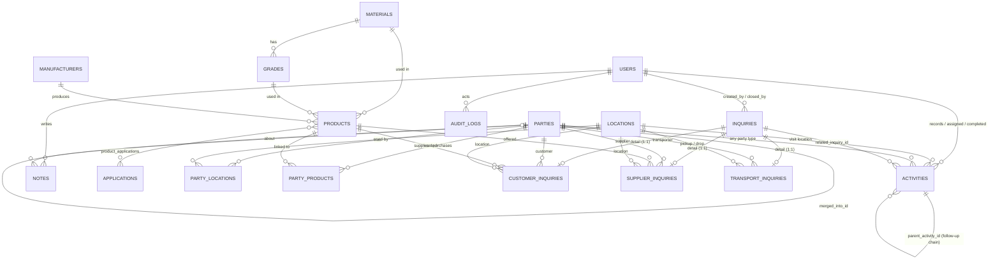

# Database design

PostgreSQL 16, fully normalised. Every master entity owns a stable surrogate primary key;
relationships are foreign keys only — names are never used as identity.

Conventions:

* `id` — `integer` identity primary key.
* `created_at` / `updated_at` — `timestamptz`, defaulted by the database, always stored in UTC.
* `status` — `ACTIVE` / `INACTIVE` soft deactivation on master data. Nothing important is ever
  physically deleted, so historical inquiries stay valid when a party or product is retired.
* Enums are stored as `VARCHAR(32)` with a `CHECK` constraint (SQLAlchemy `native_enum=False`).
  The database still rejects invalid values, while adding a new value later is a one-line
  migration instead of an `ALTER TYPE` dance.
* `ON DELETE RESTRICT` protects referenced master data; `CASCADE` is used only where the child row
  has no independent meaning (inquiry detail rows, responses, party links).

## Entity relationship diagram



## Tables

### users
Authentication and ownership. `email` unique (case-insensitive at the service layer),
`password_hash` is bcrypt, optional `phone`, indexed `role` ∈ `ADMIN|USER|SALESPERSON`
(CHECK constrained). `ADMIN` and `USER` are desk roles with CRM access; `SALESPERSON` is a field
account that can only execute its assigned activities (see [PERMISSIONS.md](PERMISSIONS.md)).
Every `created_by` / `closed_by` / `assigned_salesperson_id` / `completed_by` points here.

### materials
`name` unique. Example: PVC, HDPE, PP, LLDPE, EVA.

### grades
`material_id` → materials, `UNIQUE (material_id, name)`. A grade cannot exist without a material,
which makes an invalid material/grade pair impossible. Moving a grade to another material is
refused once products reference it.

### manufacturers
`name` unique, `code` unique when present. A manufacturer (Reliance) is *not* a supplier
(ABC Traders) — the two are separate entities.

### applications
`name` unique. Where material is used: PVC Pipes, PVC Windows, Profiles, Injection Moulding,
Packaging, Cable Insulation, Raffia.

### products
The tradable specification: `material_id` + `grade_id` + `manufacturer_id`, with
`UNIQUE (material_id, grade_id, manufacturer_id)` so a combination cannot be created twice.
`display_name` is denormalised for display only ("Reliance PVC K-67") and defaults to
manufacturer + material + grade. The service layer additionally verifies that the chosen grade
belongs to the chosen material.

### product_applications
Many-to-many junction, composite primary key `(product_id, application_id)`.

### parties
One table for `CUSTOMER`, `SUPPLIER` and `TRANSPORTER` (`party_type` enum), so the model extends
to new roles without new tables - and one table for verified parties *and* the unknown ones a
walk-in or cold call creates, so an inquiry from a brand-new customer needs no second entity.

| Column | Purpose |
|---|---|
| `stage` | `PROSPECT` / `ACTIVE` / `MERGED`. **Orthogonal to `status`**: `status` answers "may this be used for new business", `stage` answers "how well do we know it". A prospect is fully usable - that is the point |
| `source` | `DESK` / `QUICK_CREATE` / `IMPORT` / `FIELD` - where the row came from |
| `phone_normalized` | digits-only phone (last 10), maintained by the service layer. The duplicate key; indexed, deliberately **not** unique (families share numbers; a warning beats a block) |
| `merged_into_id` → parties | set when the row was folded into another party |

Constraints and indexes:

* `UNIQUE (gst_number)` stays global - the strongest dedupe key when present.
* `UNIQUE (party_type, name) WHERE stage <> 'PROSPECT'` (partial index): verified parties keep a
  unique name per type, while two different walk-ins may both be called "Patel Traders".
* `CHECK (stage <> 'MERGED' OR merged_into_id IS NOT NULL)` - a merged row always points somewhere.
* `CHECK` whitelists on `stage` and `source`.
* GIN trigram index on `name` (`pg_trgm`) for "did you mean this party?" matching; the service
  degrades to a containment search if the extension is missing.
* Plus `name`, `party_type`, `phone`, `(party_type, status)`, `(party_type, name)`,
  `(party_type, stage)`, `stage`, `phone_normalized`.

**Merging** (`POST /parties/{id}/merge`) repoints `customer_inquiries`, `supplier_inquiries`,
`transport_inquiries`, `activities` and `notes`, and repoints *and de-duplicates* `party_products`
and `party_locations` (both carry unique constraints, and only one location per party may be
primary). The loser is retired, never deleted, so old links and audit history still resolve. One
`MERGE` audit row records what moved.

### locations
Independent addresses with optional `latitude` / `longitude`. Shared by party links, customer
inquiry delivery points, transport legs and (later) transport jobs.

### party_locations
`party_id`, `location_id`, `location_type` ∈ `HEAD_OFFICE|FACTORY|WAREHOUSE|DELIVERY_LOCATION|OTHER`,
`is_primary`. `UNIQUE (party_id, location_id)` plus a **partial unique index** on `party_id`
`WHERE is_primary`, so a party has at most one primary location. A customer can therefore have a
factory and a separate delivery location.

### party_products
`party_id`, `product_id`, `relationship_type` ∈ `SUPPLIES|PURCHASES|INTERESTED_IN`, `active`.
`UNIQUE (party_id, product_id, relationship_type)` and an index on
`(product_id, relationship_type)` — this is what answers *"which suppliers can provide product X"*
and *"which customers want product X"*. The service layer enforces role sanity: suppliers may only
`SUPPLIES`, customers `PURCHASES`/`INTERESTED_IN`, transporters have no product links.

### inquiries
The common header for all three inquiry types: `inquiry_type`, `status` (`ACTIVE` | `CLOSED`),
`title`, `created_by`, `closed_at`, `closed_by`.
`CHECK (status <> 'CLOSED' OR closed_at IS NOT NULL)` - a closed inquiry always says when.
Indexes: `inquiry_type`, `status`, `(inquiry_type, status)`, `(status, created_at)`, `created_by`.

### customer_inquiries / supplier_inquiries / transport_inquiries
One-to-one detail rows keyed by `inquiry_id` (primary key *and* foreign key, `ON DELETE CASCADE`).
Each is a recorded quotation: `quantity` `NUMERIC(14,3)` with `CHECK (quantity > 0)`, a `unit`
enum and the type-specific fields:

| Table | Key fields |
|---|---|
| `customer_inquiries` | `customer_id`, `product_id`, `location_id` (nullable), `rate` (₹/kg, nullable, `> 0`) |
| `supplier_inquiries` | `supplier_id`, `product_id`, `location_id` (nullable), `rate` (₹/kg, nullable, `> 0`) |
| `transport_inquiries` | `transporter_id`, `pickup_location_id`, `delivery_location_id`, `price` (₹, nullable, `> 0`), `CHECK (pickup_location_id <> delivery_location_id)` |

Locations are independent of parties: any active location may be used on any inquiry.

**Retained history.** Migration `0007_simplified_inquiries` keeps, unused by the application, the
columns of the earlier request-and-response workflow - `inquiries.closure_reason` / `closure_note`,
`customer_inquiries.target_price` / `price_unit` / `required_by` / `notes`,
`supplier_inquiries.required_by` / `notes` / `source_customer_inquiry_id`,
`transport_inquiries.product_id` / `required_date` / `vehicle_type` / `notes` /
`source_customer_inquiry_id` - and the `inquiry_responses` table. The latest priced response was
copied into `rate` / `price` during the migration.

### activities
Activities hang off **any** party (`party_id` → parties; renamed from `customer_id` in migration
`0004`). Customers are the common case, but a cold supplier call or a transporter meeting is real
work and belongs on that party's page. The field app's read scope is unchanged - it only ever sees
activities assigned to the caller. `activity_type` ∈
`CALL|WHATSAPP|SMS|VISIT|EMAIL|MEETING`, `status` ∈ `SCHEDULED|IN_PROGRESS|COMPLETED|CANCELLED`
(both CHECK constrained).

**Assignment and field execution** (migration `0002_salesperson`):

| Column | Purpose |
|---|---|
| `assigned_salesperson_id` → users | the field user who must do it; `NULL` = the desk handles it. The service layer refuses any account that is not an active `SALESPERSON`. Indexed on its own, plus `(assigned_salesperson_id, scheduled_at)` and `(assigned_salesperson_id, status)` - exactly the two queries the mobile app makes |
| `completed_by` → users | who reported the completion (field user or desk) |
| `outcome_code` | structured result: `COMPLETED`, `CUSTOMER_INTERESTED`, `CUSTOMER_NOT_INTERESTED`, `FOLLOW_UP_REQUIRED`, `NO_RESPONSE`, `RESCHEDULED`, `OTHER`. The free-text `outcome` column stays as the narrative note |
| `location_id` → locations | where the activity happens, when the address is on file |
| `location_snapshot` (JSONB) | the address as it was when the activity was created, so a later change to the customer's location does not rewrite history. Also carries a **text-only** address ("his shop, Gondal Road") for a visit to a place with no location row yet. The field API renders the snapshot and falls back to the live row |

`CHECK ((activity_type <> 'VISIT') OR (location_id IS NOT NULL) OR (location_snapshot IS NOT NULL))`
(`NOT VALID`, so legacy rows stay readable): a visit must have somewhere to go, but a described
place counts. The field user can later pin real coordinates
(`POST /salesperson/activities/{id}/location-fix`), which fills in coordinates the location master
was missing and never overwrites ones it already has.

No separate assignment table: an activity has exactly one assignee at a time, and reassignment
history lives in `audit_logs` (`action = ASSIGN`).
A *scheduled* activity is simply `status = SCHEDULED` with a future `scheduled_at` — there is no
separate table. A *follow-up* is a new row with `parent_activity_id` pointing at the previous
activity, which forms the activity chain. `note` answers "why is this scheduled?" and `outcome`
answers "what happened?" — they are separate columns on purpose.
`related_inquiry_id` optionally ties an activity to the inquiry it was about.
Messaging columns `external_message_id`, `delivery_status`, `read_status` are already present and
nullable, so a future WhatsApp/SMS integration only adds `message_template_id`.
Checks: completed rows need `completed_at`, scheduled rows need `scheduled_at`, and an activity
cannot be its own parent. Indexes: `customer_id`, `status`, `scheduled_at`,
`(customer_id, status)`, `(status, scheduled_at)`, `(customer_id, scheduled_at)`.

### notes
Business context about a party (`party_id`, `note`, `created_by`). Deliberately party-scoped
rather than customer-scoped, so supplier and transporter notes work today.
Index `(party_id, created_at)`.

### audit_logs
System history, never shown as a business note: `user_id`, `entity_type`, `entity_id`, `action`
(`CREATE|UPDATE|STATUS_CHANGE|CLOSE|COMPLETE`), `old_value` / `new_value` as `JSONB`,
`created_at`. Indexes `(entity_type, entity_id)` and `created_at`.

## State machines

Inquiry status is two-state: `ACTIVE` ⇄ `CLOSED`, changed with `PATCH /inquiries/{id}` in either
direction. Closing stamps `closed_at` / `closed_by`; reopening clears them.

Activity status:

```
SCHEDULED ──► IN_PROGRESS ──► COMPLETED (terminal)
     └──────────────┴────────► CANCELLED (terminal)
```

Completion always goes through `POST /activities/{id}/complete` (desk) or
`POST /salesperson/activities/{id}/complete` (field), which requires an outcome and can create the
next follow-up in the same call. A field user may make only two moves - `start` (→ `IN_PROGRESS`)
and `complete` - and may create only a follow-up assigned to themselves; rescheduling, cancelling
and reassigning stay with the desk.

## Future extension points (designed, not implemented)

The schema already supports the trading engine without a redesign:

```
Customer inquiry ──► sale ──► inventory allocation ──► transport job ──► delivery
Supplier inquiry ──► purchase ──► inventory lot ──► sale
```

* New tables (`purchases`, `sales`, `inventory_lots`, `sale_allocations`, `transport_jobs`) hang off
  the existing stable keys: `parties.id`, `products.id`, `locations.id`, `inquiries.id`.
  A margin query then becomes
  `supplier → purchase → inventory_lot → sale_allocation → sale → customer`.
* `transport_inquiries` is the documented place to add `sale_id` / `purchase_id` / `transport_job_id`.
* Quantities are `NUMERIC(14,3)` and money is `NUMERIC(14,2)` everywhere, so no numeric type
  changes are needed when transactions arrive.
* `audit_logs` is generic (`entity_type` + `entity_id`), so new entities need no new audit plumbing.
